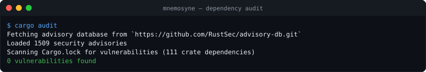
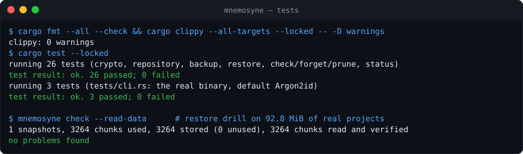

# Mnemosyne

[](https://github.com/fas0ftware/mnemosyne/actions/workflows/ci.yml)


Encrypted, deduplicating backups that **test their own restores**. One Rust binary,
no daemon, no network code: a repository is just a directory on another disk, a USB
stick or a mounted share.

Named after the Greek goddess of memory, mother of the Muses.

```text
$ mnemosyne backup ~/projects ~/Documents --exclude node_modules --exclude-caches
snapshot 20261115T162958003Z-04d9949e: 3857 files, 2045 dirs, 92.8 MiB (3857 read, 77.1 MiB added)

$ mnemosyne backup ~/projects ~/Documents --exclude node_modules --exclude-caches
snapshot 20261115T163819175Z-4fd1c163: 3857 files, 2045 dirs, 92.8 MiB (0 read, 0 B added)

$ mnemosyne check --read-data
1 snapshots, 3264 chunks used, 3264 stored (0 unused), 3264 chunks read and verified (91.9 MiB)
no problems found
```

> Status: young and not independently audited. The cryptography comes from audited
> crates and nothing is home-made. **There is no recovery without the password**:
> write it down somewhere that is not on the computer being backed up.

## Contents

- [Why](#why)
- [How it works](#how-it-works)
- [Install](#install)
- [Usage](#usage)
- [Running it on a timer](#running-it-on-a-timer)
- [Status file](#status-file)
- [Security](#security)
- [Testing](#testing)
- [Repository format](#repository-format)
- [Roadmap](#roadmap)

## Why

A backup you have never restored is a hope, not a backup. Mnemosyne makes the restore
drill part of the routine: `check --read-data` decrypts every chunk and verifies it
against its id, and the daily timer does the same for a random 10 % of the chunks, so
over a few weeks every byte has been re-read. Each result is written to a small status
file that a dashboard can show (the author's is
[Olympos](https://github.com/fas0ftware/olympos)).

## How it works

1. **Walk** the given paths (symlinks are stored as links, never followed; sockets and
   devices are skipped with a warning; unreadable files are warnings, not failures).
2. **Skip what did not change.** A file with the same size, inode, modification and
   change time as in the previous snapshot of the same paths is not read again: its
   chunk list is copied. A second backup of an unchanged 93 MB tree takes 0.4 s.
3. **Cut** the rest into content-defined chunks with
   [FastCDC](https://www.usenix.org/conference/atc16/technical-sessions/presentation/xia)
   (256 KiB to 4 MiB, 1 MiB on average). Cut points depend on the content, so inserting
   ten bytes in the middle of a large file changes one or two chunks, not all after it.
4. **Name** each chunk by a keyed BLAKE3 hash of its plaintext. Equal data is stored
   once, across files and snapshots; without the key the names say nothing about the data.
5. **Store** new chunks compressed (zstd) and encrypted (XChaCha20-Poly1305).
6. **Flush** all chunks to disk (one `syncfs`), and only then write the snapshot: the
   encrypted list of every file, its metadata and its chunks. An interrupted backup
   leaves unused chunks (prune removes them), never a snapshot pointing at missing data.

## Install

```bash
cargo build --release
install -m 755 target/release/mnemosyne ~/.local/bin/
```

Linux only (it uses `syncfs`, `utimensat` and `O_NOFOLLOW`).

## Usage

```bash
export MNEMOSYNE_REPO=/media/backup/Mnemosyne     # or --repo on every command

mnemosyne init                       # asks for a new password (twice)
mnemosyne backup ~/projects ~/Documents --exclude-file excludes.txt --exclude-caches
mnemosyne snapshots                  # list
mnemosyne ls latest ~/projects/app   # files of a snapshot (name, unique part, or latest)
mnemosyne restore latest --target /tmp/r --include ~/projects/app/README.md
mnemosyne check --read-data          # decrypt and verify everything
mnemosyne forget --keep-daily 7 --keep-weekly 8 --keep-monthly 12 --prune --dry-run
mnemosyne passwd                     # change the password (re-wraps the key, data untouched)
mnemosyne status                     # last backup and check of every repository
```

Exclude patterns without a `/` match a name anywhere (`node_modules`, `*.pyc`); with one
they match the whole path (`/home/*/Downloads`). `--exclude-caches` skips the contents of
directories marked with a standard `CACHEDIR.TAG`. The repository itself is never backed
up into itself.

Restore writes into the target directory under the original absolute paths and never
replaces existing files unless `--overwrite` is given. Permissions and modification times
are restored; ownership is not (Mnemosyne runs as a normal user).

| Exit code | Meaning |
|---|---|
| 0 | done |
| 1 | I/O error |
| 2 | usage error (bad option, missing path, not a repository) |
| 3 | wrong password |
| 4 | repository locked by another run |
| 5 | damaged data found |

## Running it on a timer

`contrib/` has what the author uses on a laptop: systemd **user** units (no root), a
small runner script and example settings. Two repositories on two different disks, so a
dead disk never takes the only copy:

```bash
install -m 755 contrib/mnemosyne-scheduled ~/.local/bin/
mkdir -p ~/.config/mnemosyne
cp contrib/run.env.example ~/.config/mnemosyne/run.env      # edit: repositories, paths
cp contrib/excludes.example ~/.config/mnemosyne/excludes

# once per repository; the first saves the password for the timers (mode 600)
mnemosyne --repo ~/Mnemosyne init --save-password ~/.config/mnemosyne/password
mnemosyne --repo /media/backup-disk/Mnemosyne --password-file ~/.config/mnemosyne/password init

cp contrib/systemd/* ~/.config/systemd/user/
systemctl --user daemon-reload
systemctl --user enable --now mnemosyne-backup.timer mnemosyne-maintain.timer
```

- `mnemosyne-backup.timer`: every hour (and 10 minutes after login), every repository.
- `mnemosyne-maintain.timer`: daily `forget --keep-last 24 --keep-daily 7 --keep-weekly 8
  --keep-monthly 12 --prune`, then `check --read-data-subset 10`.
- A repository that cannot be opened (disk unplugged) is recorded as a failed backup; the
  others still run.

The password file has to be readable by the timer, so whoever can read your home
directory can read your backups. The repositories on the *other* disk stay safe from
someone who only has that disk.

## Status file

`~/.local/state/mnemosyne/status.json` (or `$MNEMOSYNE_STATUS`): per repository the
last backup, the last good backup, the last check, the snapshot count and the size.
No file names, no keys. `mnemosyne status --json` prints it.

```json
{
  "version": 1,
  "repos": {
    "/home/user/Mnemosyne": {
      "last_backup": { "time": "2026-11-15T16:34:07.349Z", "ok": true, "snapshot": "20261115T163407349Z-…",
                       "files": 3893, "bytes": 113663590, "added_bytes": 0, "warnings": 0, "duration_ms": 412 },
      "last_good_backup": { "…": "…" },
      "last_check": { "time": "2026-11-15T16:33:01Z", "ok": true, "bytes": 9751552, "read_data": "10%" },
      "snapshots": 2,
      "repo_bytes": 91435008
    }
  }
}
```

## Security

- Password → **Argon2id** (64 MiB, 3 passes) → wrapping key → decrypts 64 bytes of random
  master key material (an encryption key and an id key). `passwd` re-wraps those bytes
  only. Settings that ask for more than 1 GiB, 16 passes or 8 lanes are refused before
  any work, so a planted `config.json` cannot freeze the machine.
- The config header (format, id, chunker, KDF settings, salt) is authenticated together
  with the wrapped key: weakening the KDF in the file makes the password fail.
- Every chunk and snapshot: zstd, then **XChaCha20-Poly1305** with a fresh random 24-byte
  nonce. The associated data binds the repository id, the blob kind and the blob name,
  so blobs cannot be swapped, renamed or moved between repositories unnoticed.
- Every chunk read is verified twice: authentication tag, then keyed BLAKE3 against its
  name. Decompression is capped (16 MiB per chunk), so a crafted blob cannot inflate.
- Restore treats snapshots as untrusted: absolute clean paths only (no `..`), files are
  opened with `O_NOFOLLOW`, no parent directory may be a symlink, links are created
  last. A test restores hostile snapshots and checks nothing lands outside the target.
- Files are written to `tmp/` and renamed; a lock file stops two writers; `prune` refuses
  to run if any snapshot cannot be read (its chunks would look unused).
- Keys are wiped from memory on drop (`zeroize`). No network code, no telemetry.
- The password file must be mode 600, like an SSH key.

What it does not protect against: someone who can read your home directory while the
password file is there, and metadata visible on disk (number and sizes of chunks, snapshot
times in their names).



## Testing

```bash
cargo fmt --all --check
cargo clippy --all-targets --locked -- -D warnings
cargo test --locked
```



- 26 unit tests: tampering with any byte of a blob, swapping blobs, wrong keys, the
  decompression cap, KDF limits, header tampering, locks (stale, foreign), dedup and
  content-defined boundaries (10 changed bytes in a 3 MB file → at most 2 new chunks), oversized repository files refused before reading,
  excludes and `CACHEDIR.TAG`, unreadable files, non-UTF-8 names, restore of contents,
  modes, times and links, partial restore, hostile snapshots, keep policies,
  forget/prune/check, a damaged and a missing chunk.
- 3 end-to-end tests run the real binary with the default Argon2id: full cycle with a
  byte-for-byte comparison of the restored tree, wrong password and loose password-file
  permissions, a damaged chunk caught by `check --read-data` and refused by `restore`.
- CI also backs up its own checkout, restores it and compares it with `diff -r`.
- By hand, on the author's laptop: 3857 files / 92.8 MB of real projects from an NTFS
  USB disk. First backup 8 s, unchanged second backup 0.4 s, full read check 0.6 s,
  restore 2.3 s, `diff -r` identical; the same on a repository on the NTFS disk.

## Repository format

```text
config.json            format, id, chunker, KDF settings, wrapped master key (plain JSON)
data/ab/ab12…          chunks: "MNEM" | version | kind | 24-byte nonce | XChaCha20-Poly1305(zstd(data))
snapshots/<time>-<id>  snapshots, same blob format, JSON inside
locks/lock             who holds the lock (host, pid, time, operation)
tmp/                   files being written
```

Format version 1. Future versions will read it or say clearly that they cannot.

## Roadmap

- Packs: many small chunks in one file (fewer files on slow USB sticks and network shares).
- A second key slot (recovery key printed on paper next to the password).
- `diff` between two snapshots, `mount` with FUSE.
- Optional off-site copy (an rclone remote), still with all encryption on this side.

## License

MIT
